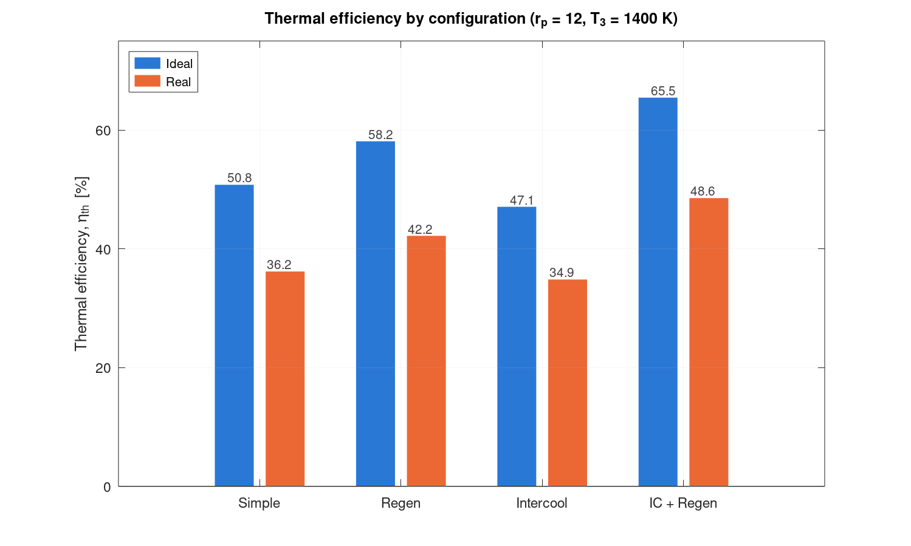
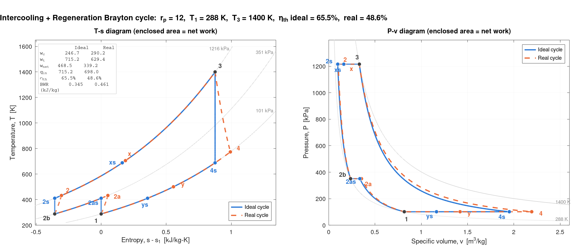
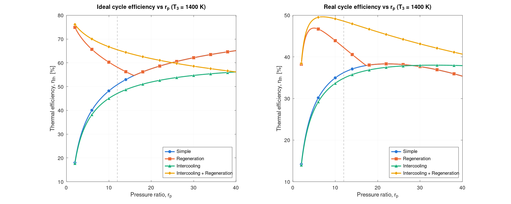

# Brayton Cycle Analysis of a Turbojet

Thermodynamic analysis of the air-standard Brayton cycle behind a turbojet engine, comparing four configurations: **simple**, **regeneration**, **two-stage intercooling**, and **intercooling + regeneration**. Each is solved as an ideal cycle and as a real cycle with component losses, plus a turbojet thrust calculation and a pressure-ratio sweep.

**Headline result:** combining intercooling with regeneration raised real-cycle thermal efficiency from **36.2% to 48.6%** (+34% relative) and net work by **22%**, at a pressure ratio of 12 and a turbine inlet temperature of 1400 K.



## Results

Operating point: rp = 12, T1 = 288 K, P1 = 101.325 kPa, T3 = 1400 K. Real cycle: compressor efficiency 0.85, turbine efficiency 0.88, regenerator effectiveness 0.80.

| Configuration | Thermal efficiency (ideal) | Thermal efficiency (real) | Net work, real (kJ/kg) | Back work ratio, real |
| --- | --- | --- | --- | --- |
| Simple | 50.8% | 36.2% | 277.3 | 0.559 |
| Regeneration | 58.2% | 42.2% | 277.3 | 0.559 |
| Intercooling | 47.1% | 34.9% | 339.2 | 0.461 |
| Intercooling + Regeneration | 65.5% | **48.6%** | 339.2 | 0.461 |

Key findings:

- **Component losses dominate.** Realistic compressor and turbine efficiencies cut the simple cycle from 50.8% to 36.2%; more than half the turbine's work goes back into the compressor.
- **Regeneration raises efficiency, not work** (+6.0 points real). Exhaust heat replaces part of the fuel heat.
- **Intercooling alone lowers efficiency** (−1.4 points real) even though it raises net work 22%. The colder compressor exit means the combustor must add more heat.
- **Together they work.** Intercooling lowers the compressor exit temperature, so the regenerator can recover far more exhaust heat (273 K of preheat vs 108 K without intercooling).
- **Regeneration has a limit.** It stops helping above rp ≈ 17 (real) for the simple cycle, because the turbine exhaust becomes colder than the compressor exit. Intercooling pushes that limit past rp = 40.
- **Turbojet trade-off.** At sea-level static conditions, intercooling raises specific thrust 10% (792 → 871 N per kg/s) but raises thrust-specific fuel consumption 15% (22.5 → 26.0 mg/N·s).





## How it works

The analysis is split between two programs so calculation and presentation can be checked separately:

| File | Language | Purpose |
| --- | --- | --- |
| `brayton_numbers.py` | Python 3 (standard library only) | Solves all cycles, the turbojet and the rp = 2–40 sweep; writes the CSV results |
| `brayton_figures.m` | MATLAB (R2019b+, no toolboxes) | Reads the CSV files; draws 9 figures and writes `tables.txt` |
| `cycle_path.m` | MATLAB | Helper that builds smooth process paths between state points for plotting |

Outputs already in the repo:

- `results_summary.csv`, `state_points.csv`, `rp_sweep.csv`, `jet_results.csv`, `inputs.csv` — numerical results
- `figures/` — T-s and P-v diagrams for each configuration, an overlay, efficiency and net-work sweeps, and turbojet performance
- `tables.txt` — inputs, state points, performance, change vs simple cycle, turbojet results

## Run it

```bash
python brayton_numbers.py      # writes the CSV files
```

Then in MATLAB, with this folder as the Current Folder:

```matlab
brayton_figures                % writes figures/ and tables.txt
```

Always run Python first. To study a different operating point, change the inputs at the top of `brayton_numbers.py` and rerun both.

## Assumptions

Cold-air-standard: air as an ideal gas with constant specific heats (cp = 1.005 kJ/kg·K, k = 1.4), combustion modeled as constant-pressure heat addition, fuel mass neglected, no pressure losses in the combustor or heat exchangers, and two-stage intercooling with equal pressure ratios back to the inlet temperature. These make the absolute efficiencies optimistic; the ranking of the configurations is not expected to change.

## Verification

The simple, regenerative and intercooled cycles were solved by hand and the program matches to rounding (for example T2s = 585.8 K, simple ideal efficiency 50.8% from both the energy balance and 1 − 1/rp^((k−1)/k)). Every case also passes first-law closure, stays below the Carnot limit of 79.4%, and shows entropy increasing across the real compressor and turbine.

## References

- Y. A. Çengel and M. A. Boles, *Thermodynamics: An Engineering Approach*, McGraw-Hill — Gas Power Cycles chapter.
- M. J. Moran, H. N. Shapiro et al., *Fundamentals of Engineering Thermodynamics*, Wiley.

---

Kent · Mechanical Engineering, University of Oklahoma
